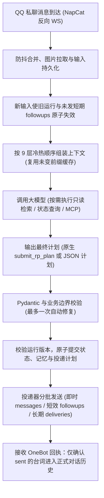

# Linger — 面向真实私聊体验的独立角色扮演系统

[中文](README.md) · [English](README.en.md)

这是一个面向 **QQ 私聊（OneBot v11 / NapCat）** 的独立角色扮演（RP）与持续生活服务，自带完整的 Web 管理台。

不同于常见的“写小说式”酒馆对话或依赖定时轮询的聊天机器人，本项目采用 **Python 3.13 + FastAPI + SQLite + Vue 3** 单进程轻量架构，核心设计围绕两件事展开：
1. **打造像真人发微信 / QQ 一样的私聊沉浸感与时间流动感**；
2. **用明确的状态边界、单轮前瞻分支与分层前缀缓存，减少重复推理和输入开销。**

**模型体验与系统职责：** 自然对白、情绪理解、人物一致性和分支内容由所选模型、角色卡与预设共同影响，以下示例是设计目标，并非所有模型都能稳定达到的效果。系统负责资料与权限边界、计划校验、运行取消、持久调度和网关回执；接口连通或计划通过校验，不代表角色表现一定自然，也不代表 QQ 已确认送达。

---

## 一、私聊更有“真人感”!

传统 RP 往往容易陷入两种割裂感：要么像在写网文（发一句“好累”，模型先写三段环境光线、眼神流转和心理剖析说明书，最后机械反问“你呢？”）；要么是“你不说话，世界就彻底静止”，或者靠傻瓜定时器每隔半小时盲目查岗（“在干嘛？”）。

本系统从**内置预设体系**到**底层分支调度**，全链路为「真实社交软件上的私聊体感」服务：

### 1. 去小说腔、去客服味的默认预设体系
系统内置可编辑的 **「RP 通用默认」** 与可选 **「日常对白沉浸感」** 预设基线，开箱即针对私聊场景做了深度调校：
* **交流与情绪优先，场景克制**：先接住用户当下真正表达的话意与情绪——日常分享时自然接话、抛梗搞怪时配合拆台或破功、低落焦虑时给予偏袒与陪伴。环境与动作仅在影响互动时顺手点缀，绝不为了凑氛围每轮重新布景，也不用“不是因为 A，而是因为 B”做心理剖析。
* **真人的气泡呼吸感（1—2 条常态，说完即止）**：即时回复以 1—2 条气泡为常态（最多不超过 3 条），按自然意群分条；能一句话说清就只发一条，支持短句、留白与微停顿，句尾不再每次机械抛问题求互动。
* **保有独立的“自我”与生活重心**：角色不是唯唯诺诺的应声虫，有自己手头正在忙的事（如画画、看书、挑东西）和具体喜好，允许温和的分歧、调侃或吐槽；角色卡中标注为“偶尔”的小脾气或口癖只作自然点缀，不演成每轮必犯的机械套路。
* **诉求与纠错真正生效**：当用户明确表示不满或纠正（如“别催我”“还想再待会儿”），角色会真正停下原有的催促惯性、调整互动选择，不会表面道歉后下一句换个温柔词继续催睡或盘问。

### 2. 读懂“沉默原因”的分支时间线（`followups` 与 `deliveries`）
真人在发完消息的那一刻，心里本来就会预想“如果他没回我，我等下怎么接”。本系统的分支系统正是为了复刻这种真实的心理惯性：
* **先理解为什么停顿，再决定何时开口**：
  * **热聊突然中断 / 话留半截**：首条通常在 1—5 分钟内自然接话；角色熟稔或兴致正高时，甚至支持真人聊天框里的短促连发（如 `6分“怎么没声了……”` → `6分10秒“？”` → `6分30秒“现在就去啦？”` → `7分“……”`，随后安静停下）。
  * **对方正在看资料 / 挑外卖 / 思考**：先留出做这件事的合理时间（如等 5—15 分钟），再顺着话题问“有想吃的没？”“看入迷啦？”，不把思考时间当成冷落；事项一旦解决便立即停止追问。
  * **给出了明确返回时间（如 23:16 说“洗完大概 12 点，一会聊”）**：根据服务器真实时钟跨过午夜安静等待，到 `00:03` 才轻问“还洗着呢？”，`00:15`“睡着啦？”，`00:35`“那明天再聊，晚安”，绝不死板地按固定 3 分钟去催。
  * **深夜亲近 / 明确不打扰**：时间到了深夜或场景在床上并不自动等于“必须催睡觉”；当用户表示忙碌、需要独处或已道晚安时，短期分支主动留白 `[]`，并将次日问候转入跨聊天保留的 `deliveries`。
* **严守未回复的事实边界**：在收到用户新消息前，角色只根据“时间流逝 + 仍无新回复”做自然询问或猜测，绝不替用户脑补既成事实（绝不预写“听见你开门回来了”）。

---

## 二、核心架构与工程亮点

### 1. 单轮前瞻的短效分支（Ahead-of-Time Followups）——到期无需再次推理
* **告别烧钱的定时轮询**：传统主动聊天方案依靠 Cron 定时器反复唤醒大模型，每次都要重读几万 Token 的完整历史，成本高昂且极易脱离当下的对话气氛。
* **一次推理，两手准备**：本系统在当轮生成即时回复（`messages`）时，将未回复分支（`followups`）与长期约定（`deliveries`）作为结构化计划一并提交。预写计划仍消耗输出 Token；到期执行已保存台词时，无需为这条投递再次调用模型。
* **新输入即刻原子作废**：只要用户在到期前发来新消息，后台挂起的临时 `followups` 瞬间全部取消作废，绝不产生“前言不搭后语”的僵尸穿插消息；若用户确实未回，到期后由底层调度器直接投递保存好的台词，无需再次调用大模型。

### 2. “生成 ≠ 送达”的真实事实与事务边界
* **确认送达才算说过**：模型生成的文本或未触发的后续分支绝不直接混入历史。只有经 OneBot 网关返回确认送达（`succeeded` / `sent`）回执的气泡，才会作为共同经历写入对话历史。
* **未知回执绝不盲目重发**：遇到网络超时或网关返回 `unknown` 时，系统保留真实未知状态供管理端核对，绝不自动重发导致重复刷屏。
* **网络等待与数据库写事务解耦**：模型 HTTP 请求、图片下载与外部 MCP 调用期间绝不持有 SQLite 写事务；取消或新消息到达时，旧运行版本（`StaleRun`）不得提交正式状态。

### 3. 分层上下文与稳定前缀缓存复用
系统提供独立的**上下文策略库**（支持「成本优先」与「对话连续性优先」两种模式），严格按变化频率由冷到热组装请求前缀：
1. `system`：应用规则与稳定排序的 Tool / MCP 声明
2. `preset`：已采用的模型提示词预设与前置块
3. `world` / `character`：世界书与角色卡设定（含固定人物一致性提醒）
4. `profile` / `state`：有证据来源的长期用户画像与低频冻结的生活状态快照
5. `retrieval` / `summary`：按需检索快照与历史轻摘要（固定在近期历史之前）
6. `history`：近期完整对话历史（采用 `100 → 40` 轮阶梯式批量淘汰，避免滑窗逐轮击穿缓存）
7. `input` / `runtime`：本轮新输入（纯文字转入历史时保持零改写包装）与尾部服务器运行封套

在个人部署的部分连续短对话记录中，使用同一连接、稳定设定且没有检索或图片时，曾观察到约 **95%—97%** 的缓存读取占比。这是特定使用条件下的观察结果，不是跨模型基准或命中率承诺。实际比例受服务商缓存机制与有效期、前缀变更、上下文淘汰和新输入长度等影响；以接口返回且能够配对的缓存读取量／输入量统计，缺失用量不按零计算。Gemini 显式缓存也需端点与模型支持，不能与其他提供商的隐式缓存效果直接等同。

### 4. 多协议原生适配与双轨计划输出
* **四大原生协议**：不靠模型名字猜字段，显式支持 OpenAI `Chat Completions`、OpenAI / DeepSeek `Responses`、Anthropic / DeepSeek `Messages`、Google `Gemini Generate Content`，以及 OpenAI / Ollama / Gemini 向量嵌入。
* **原生工具与 JSON 计划双轨**：
  * 支持通过原生工具 `submit_rp_plan` 提交结构化决策（含同轮只读查询工具循环与原生思考签名续接）；
  * 在模型的 **工具策略 → 计划输出** 选择“系统默认／JSON计划／原生工具提交”。DeepSeek Chat／Responses默认仍为JSON，其他连接保持原生工具；可按模型手动切换，失败不自动换通道。
  * JSON适配覆盖四套生成协议：OpenAI Chat／Responses使用严格JSON Schema，DeepSeek及其他Chat／Responses兼容端点使用JSON对象，Messages使用`output_config.format`，Gemini使用`generationConfig.responseMimeType/responseJsonSchema`。DeepSeek Messages官方不支持JSON格式字段，须使用Chat／Responses。查询及思考继续原生续接，最终计划共用`validate_plan`后入库。

### 5. 持续生活扩展、带证据链的私有记忆与 Web 管理台
* **严进且有据可查的记忆（`sources`）**：所有新增或修改的长期记忆、场景变更、角色微调提案均须附带真实的来源编号（`input` / `sent` / `life` / `world_event` / `observation`），拒绝把单轮临时情绪上升为长期刻板印象。
* **兼容酒馆生态与生活扩展**：支持导入 SillyTavern 角色卡（PNG / JSON）、世界书与聊天补全预设；支持可选的关键词 / 语义混合检索、近期日程（`schedules`）、世界事件候选（`events`）、公开网页观察（`observations`）及逐生活线授权的只读 MCP 服务。
* **完备的 Web 管理端**：提供连接与最小计划检查、上下文窗口胶囊占用条与缓存命中核算、投递队列与已取消回收箱、按天/按模型用量与自设价格账单、在线一致性备份与停服恢复。

---

## 三、系统运行流程



---

## 四、快速开始

### 环境要求
* **Python**：`3.13+`
* **Node.js**：`20.19+`（含 `npm`，用于构建前端管理页）
* **QQ 协议端**：[NapCatQQ](https://github.com/NapNeko/NapCatQQ)（OneBot v11 反向 WebSocket）

### 方式一：Windows 本地一键运行
依次双击根目录下的三个脚本：
1. **`安装依赖.bat`**：自动创建专属 `.venv` 虚拟环境，安装前后端依赖并完成管理端生产构建（看到“安装完成”后再进行下一步）。
2. **`初始化.bat`**：设置管理员密码（默认管理员账号为 `admin`，无默认密码，已有账户切勿重复初始化）。
3. **`启动.bat`**：启动单进程服务，浏览器访问 `http://127.0.0.1:18765` 登录管理台。

### 方式二：Linux / 命令行手动启动
```sh
python3.13 -m venv .venv
.venv/bin/python -m pip install -e backend
npm --prefix web install
npm --prefix web run build
.venv/bin/python -m rp_server init
.venv/bin/python -m rp_server serve
```

### 方式三：Docker Compose 部署
适用于 Linux 云服务器（自带 Caddy 自动管理 HTTPS 与反向代理）：
```sh
cp deploy/.env.example deploy/.env
# 编辑 deploy/.env，将 RP_DOMAIN 改为你的域名
docker compose --env-file deploy/.env -f deploy/compose.yaml build rp
docker compose --env-file deploy/.env -f deploy/compose.yaml run --rm rp init --username admin
docker compose --env-file deploy/.env -f deploy/compose.yaml up -d
```
> 若 NapCat 与 RP 运行在同一台宿主机，启动时叠加 `-f deploy/compose.same-host.yaml` 即可仅对本机暴露 `127.0.0.1:18765`。NapCat 在其他容器中运行时，需将它接入 RP 的容器网络并使用服务名连接；容器内部的 `127.0.0.1` 不指向宿主机。

---

## 五、首次配置四步走

1. **添加模型连接**：
   进入「模型与连接」，选择提供商与协议，填写服务基础地址（如 `https://api.deepseek.com` 或 `https://api.openai.com`，系统会自动按协议补全端点路径）与 API Key，添加模型并分配至「主叙事」用途。可点击「最小计划检查」验证连通性。
2. **准备角色与预设**：
   在「预设」中查看或微调默认的 `RP 通用默认`（可按需勾选启用「日常对白沉浸感」模块）；在「角色」与「世界书」中创建设定或直接导入酒馆角色卡。
3. **对接 NapCat（OneBot v11）**：
   进入「QQ 接入」，新建机器人账号并设置独立连接令牌（至少 24 位 ASCII 字符），复制生成的 `ws://127.0.0.1:18765/onebot/v11/<账号ID>`。在 NapCat 网络配置中新建 **反向 WebSocket 客户端**，填入该 URL 与 Token，消息格式设为 `array`。
4. **绑定联系人并开启回复**：
   用你的个人 QQ 给机器人发一条私聊消息，消息会自动出现在「联系人」列表。为该联系人绑定角色实例与上下文策略，打开「生活与运行」中的自动回复开关，即可开始对话。

---

## 六、模型接入：思考模式与工具兼容速查

不同厂商对「思考模式（Reasoning / Thinking）」与「强制工具调用（`tool_choice`）」的组合有各自的协议约束，系统已做显式适配：

| 提供商／协议 | 思考字段 | 计划提交方式与当前处理 |
| --- | --- | --- |
| **DeepSeek Chat Completions** | `thinking` + `reasoning_effort` | **结构化 JSON 计划**：发送 `response_format: {type: json_object}`；保留思考档位，原生查询工具使用 `auto`，最终完整JSON经业务校验后提交。 |
| **DeepSeek Messages** | `thinking` + `output_config.effort` | 原生工具链路：思考开启下使用 `any`（官方端点实测 `low + any` 返回 200 且含思考块；指定单一工具返回 400）。非思考下修复可指定工具。 |
| **DeepSeek Responses** | `reasoning.effort` | **结构化 JSON 计划**：发送 `text: {format: {type: json_object}}`；与Chat使用同一计划解析、业务校验和投递，原生查询使用 `auto`，不再依赖最终提交工具。 |
| **OpenAI Chat / Responses** | `reasoning_effort` / `reasoning.effort` | 默认原生工具：`required`及修复指定提交；可切换严格JSON Schema，查询使用`auto`。Responses原生推理项与`call_id`保持。 |
| **Claude Messages** | `thinking.type`（含预算）与 `output_config.effort` | 默认原生工具，思考开启／未知时使用兼容选择；可切换`output_config.format` JSON Schema，与effort并存，不改变思考。 |
| **Gemini Generate Content** | `thinkingConfig`（`thinkingLevel` / `thinkingBudget`） | 默认原生工具`ANY`及修复允许名单；可切换JSON MIME／Schema，查询使用`AUTO`。保留`thoughtSignature`与原生`parts`，实际模型须支持格式／查询组合。 |
| **其他 OpenAI 兼容反代** | 按实际端点能力配置 | 可手动选择JSON对象或原生工具；端点须支持对应字段。不按模型名猜能力，不在失败后自动降级或关闭思考。 |

---

## 七、收到消息却没回复：分阶段排查指南

当 QQ 发了消息但没收到回复时，请按「输入记录 → 运行详情 → 投递记录」依次定位（**请求返回 200、生成合法计划、到达投递时间、QQ 确认送达是四个独立阶段**）：

| 看到的现象 | 优先排查方向 |
| --- | --- |
| **RP 没有入站记录** | 检查 NapCat 是否在线、反向 WebSocket 地址与 Token 是否匹配、消息格式是否为 `array`。 |
| **有入站记录，但没有触发运行** | 检查「生活与运行」全局自动回复开关、该联系人的暂停状态、防抖等待时间，或是否有旧任务正在取消。 |
| **有运行，模型请求报 HTTP 400** | 查看运行详情中的实际端点、模型名、思考参数与 `tool_choice` 组合；此时尚未生成任何 QQ 消息。 |
| **请求 200，但提示缺少计划或校验失败** | 查看模型是否只返回了普通文本、JSON 被 `max_output_tokens` 截断，或填写了未授权的素材/来源编号（系统会自动触发最多一次修复）。 |
| **计划已生成，消息处于待发或已回收** | 查看计划的延迟秒数（`followups`）或目标时刻（`deliveries`）、安静时段限制，或是否因你紧接着发了新消息而被系统正常取消回收。 |
| **投递记录显示失败或 `unknown`** | 检查 OneBot 网关连接与返回码；为防止重复发消息，`unknown` 状态不会自动重发，可在核对 QQ 实际界面后于管理端手动确认处理。 |

---

## 八、目录结构与数据保护

```text
RP/
├── backend/                      FastAPI 后端服务、RP 引擎、多协议模型层与 SQLite 存储
├── web/                          Vue 3 + TypeScript + Element Plus 管理前端
├── deploy/                       Docker Compose 与 Caddy HTTPS 部署配置
├── scripts/                      Windows 安装、初始化、构建与启动 PowerShell 脚本
├── 安装依赖.bat                   Windows 一键安装环境与构建前端
├── 初始化.bat                     Windows 首次设置管理员密码
├── 启动.bat                       Windows 启动本地 RP 服务
├── SOURCE_ORIGINS.json           自有 Harness 提取来源与内容指纹
├── README.en.md                  English overview and setup
└── README.md                     项目主页说明
```

- `data/` 是本地运行数据，公开仓库不附带数据库、聊天、角色私有资料、模型密钥、SSH 凭据、服务器实际配置或私人语料。
- 默认管理地址是 `http://127.0.0.1:18765`。改变监听地址／端口时同步设置 `RP_PUBLIC_URL`；前端开发来源另用 `RP_ALLOWED_ORIGINS`。应用不会自动读取 `.env`，容器配置由 Compose 传入。
- `RP_DATA_DIR` 指定数据目录，`RP_MASTER_KEY_FILE` 指定服务器主密钥文件，`RP_STATIC_DIR` 指定已构建管理端。密钥需与原数据库配套保管；只备份数据库不能保证解密已有凭据。
- 管理端提供在线数据库一致性备份。完整恢复还需要附件和服务器主密钥；替换运行数据库前应停止服务，保留原数据，不能用复制正在写入的 SQLite 主文件代替一致性备份。
- 单进程运行，不要增加多个 worker。已有部署不重复初始化，不要用删除数据卷作为重启方式。
- 用量页按接口实际返回统计；输入已包含缓存部分，输出已包含推理部分，不重复相加。失败、重试和取消的请求也可能计费，缺失用量标为未知。

## 九、来源与许可

模型协议、Provider 和部分基础机制提取／改编自作者自己的 Python Harness，来源与内容指纹见 `SOURCE_ORIGINS.json`。运行时不依赖旧桌面项目，不包含其私人配置、数据或 Qt 界面。

实际依赖在 `backend/pyproject.toml`、`web/package.json` 与 `web/package-lock.json` 中列出。依赖包及第三方项目保留各自许可证；本仓库未附带下载的参考项目或游戏语料。本次源码公开尚未指定项目许可证。


